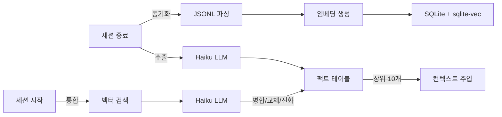
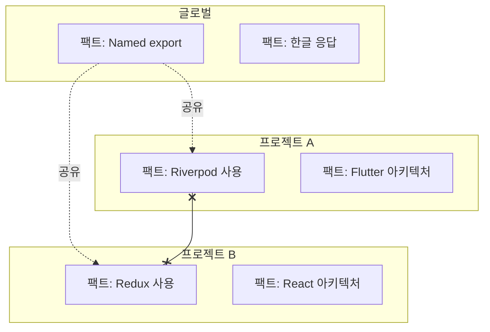

# Memory Bank

> Claude Code 대화를 위한 시맨틱 검색 + 팩트 자동 추출


## 주요 기능

- **대화 검색** -- 모든 과거 대화에서 시맨틱 벡터 검색
- **팩트 추출** -- 대화에서 결정, 선호, 패턴을 자동 추출
- **팩트 통합** -- 중복 감지, 모순 처리, 변화 추적
- **범위 격리** -- 프로젝트 팩트는 해당 프로젝트에만, 글로벌 팩트는 공유
- **MCP 연동** -- Claude용 `search`, `read`, `search_facts` 도구 제공
- **Web UI** -- 대화 탐색 및 검색을 위한 다크 테마 웹 인터페이스

## 동작 원리



## 설치

Claude Code에서:
```
/plugin marketplace add https://github.com/jung-wan-kim/memory-bank
/plugin install memory-bank
```

## 업데이트

```
/plugin update memory-bank
```

## 빠른 시작

```bash
memory-bank sync      # 대화 동기화 및 인덱싱
memory-bank search "React 인증"  # 시맨틱 검색
memory-bank stats     # 인덱스 통계
```

## 팩트 시스템

세션 종료 시 팩트를 자동 추출하고, 세션 시작 시 통합합니다.

| 카테고리 | 예시 |
|----------|------|
| `decision` | "상태 관리에 Riverpod 사용" |
| `preference` | "Named export만 사용" |
| `pattern` | "에러 시 bug-fixer 3회 재시도" |
| `knowledge` | "API 엔드포인트: /api/v2/" |
| `constraint` | "localStorage 사용 금지" |

### 통합 규칙


| 관계 | 처리 |
|------|------|
| DUPLICATE | 병합 (count++) |
| CONTRADICTION | 기존 팩트 교체 + 수정 이력 |
| EVOLUTION | 업데이트 + 수정 이력 |
| INDEPENDENT | 양쪽 유지 |

### 범위 격리



프로젝트 A에서 보이는 팩트: 프로젝트 A 팩트 + 글로벌 팩트 (프로젝트 B는 절대 안 보임).

## MCP 도구

| 도구 | 설명 |
|------|------|
| `search` | 대화 시맨틱/텍스트 검색(결과는 `limit` 개까지, 날짜·에이전트 필터). 개념 2~5개를 배열로 주면 모두에 맞는 대화를 찾아, 낱말 일치와 의미 일치를 한 순위로 섞어 보여 줌 |
| `read` | 대화(또는 줄 범위)를 Markdown 으로 읽기 — 한 번에 40,000자까지. 넘으면 맺음 줄이 이어 읽을 `startLine` 을(긴 메시지 한 건 안에서 멈췄으면 `startChar` 도) 알려 줌 — 알려 준 값을 전부 넘긴다(`startLine` 만 넘기면 그 메시지가 처음부터 다시 나온다). `full: true` 는 2,000자에서 잘리는 도구 입력·결과를 전부 보여 줌 |
| `search_facts` | 카테고리·에이전트·태그 필터로 팩트 검색(같은 문장은 한 번만) |
| `search_ontology` | 온톨로지를 단계별로 보기: 도메인과 분류별 건수 → `category` 필터로 팩트. 분류가 200개를 넘는 도메인은 `category_offset` 으로 이어서 나열 |
| `ask_avatar` | 과거 결정에 근거해 사용자가 할 법한 답을 받기(LLM 호출). 로그인 없음·거절·장애로 호출이 실패하면 답이 아니라 오류(`isError`)로 돌려줌 |
| `trace_fact` | 팩트가 나온 대화까지 거슬러 올라가기 |
| `explore_graph` | 팩트에서 관계를 따라 1~3단계 탐색 |
| `cross_project_insights` | 다른 프로젝트의 비슷한 결정 찾기 |
| `graph_stats` | 지식 그래프 통계 |
| `tag_fact` | 팩트의 사용자 태그 추가·삭제·교체 |
| `list_tags` | 사용자 태그 목록, 또는 그 태그가 붙은 팩트 |

인자·상한·잘렸을 때 응답이 적는 문구는 [`skills/remembering-conversations/MCP-TOOLS.md`](skills/remembering-conversations/MCP-TOOLS.md) 에 있습니다.

검색 결과의 `N% match` 는 임베딩의 코사인 유사도이지 확신도가 아닙니다. 이 모델에서는 무관한 글도 85~89% 쯤 나오고 잘 맞는 결과가 90% 안팎입니다. 한 응답 안의 결과끼리 견줄 때만 쓰고, "88%" 를 "관련 있음"으로 읽지 마세요.

### search_facts 예시

```json
{
  "query": "상태 관리",
  "category": "decision",
  "include_revisions": true,
  "limit": 10
}
```

## Web UI

대화 기록을 탐색하고 검색할 수 있는 시네마틱 다크 테마 웹 인터페이스입니다.


### 기능

- **프로젝트 뷰** -- 카테고리별 그룹, 최신/최다/A-Z 정렬로 전체 프로젝트 탐색
- **검색** -- 전체 대화에서 텍스트 검색
- **사용자 프롬프트** -- 사용자 메시지만 조회 및 검색
- **상세 보기** -- 사용자/어시스턴트 전체 메시지와 도구 호출 이력 확인
- **Hue OS 퍼블리케이션** -- `~/.codex/personal-mirror`의 개인 미러 산출물 기반 질의응답 전용 대화 인터페이스

### 실행

```bash
node ui/server.cjs
# Listening on 127.0.0.1:3847 (this machine only)
# Memory Bank UI: http://localhost:3847
# Hue OS: http://localhost:3847/hue-os
```

포트 변경:
```bash
PORT=8080 node ui/server.cjs
```

> **이 기기 전용입니다.** 대시보드는 대화 전문·도구 입력·사실을 로그인 없이 보여 주므로 `127.0.0.1` 에만 열리고, 이 기기의 브라우저가 직접 보낸 같은 출처 요청에만 답합니다. CORS 헤더를 보내지 않고, `Host`·`Origin` 이 다르거나 프록시 헤더(`X-Forwarded-For` 등)가 붙은 요청은 403 입니다. `limit` 은 요청당 200행, 요청 본문은 1MB 가 상한입니다.
> 다른 주소에 열려면 `MEMORY_BANK_UI_HOST` 와 `MEMORY_BANK_UI_TOKEN`(16자 이상 — 토큰이 없으면 서버가 시작을 거부합니다)을 **둘 다** 정합니다. 그러면 모든 화면과 API 가 토큰을 요구합니다: `Authorization: Bearer <토큰>`, 또는 브라우저에서 `/?token=<토큰>` 을 한 번 열면 HttpOnly 쿠키로 바뀝니다.
> **이 포트에 터널이나 리버스 프록시를 연결하지 마세요** — 아래 Hue OS 공개 리스너를 쓰세요.
> Hue OS 로그인 제한과 하루 대화 한도는 접속 주소별로 셉니다. 이 포트에서는 연결 자체의 주소를 쓰므로, 토큰을 정하고 직접 운영하는 리버스 프록시를 앞에 두면 모든 사용자가 프록시 주소 하나로 세어집니다. `MEMORY_BANK_UI_TRUST_PROXY=1` 을 주면 이 포트도 `X-Forwarded-For` 에서 주소를 읽습니다 — 직접 운영하는 프록시가 그 헤더를 쓸 때만 켜세요(아니면 호출자가 아무 값이나 적어 보낼 수 있습니다). Hue OS 공개 리스너는 항상 그 헤더를 읽습니다.

> **참고:** 데이터베이스를 채우려면 먼저 `memory-bank sync`를 한 번 이상 실행해야 합니다.
> Hue OS 퍼블리케이션(`/hue-os`, `/replacement-os`는 호환 alias)은 대화 DB가 없어도 로컬 Personal Mirror 산출물에서 로드됩니다.
> 채팅은 API 키가 아니라 로컬 터미널 CLI를 기본으로 씁니다: Claude는 `claude --print --model sonnet`, GPT는 `codex exec --model gpt-5.5`.
> `REPLACEMENT_OS_CLAUDE_COMMAND`, `REPLACEMENT_OS_CLAUDE_ARGS_JSON`, `REPLACEMENT_OS_GPT_COMMAND`, `REPLACEMENT_OS_GPT_ARGS_JSON`로 명령을 바꿀 수 있습니다.
> 로컬 터미널 provider가 없으면 안전 경계를 지키는 deterministic fallback으로 응답합니다.
> 공유용 보호 장치: `/hue-os`는 비밀번호 로그인이 필요합니다. `REPLACEMENT_OS_ACCESS_PASSWORD` 를 직접 정하세요 — 기본값은 없고, 정하지 않으면 로그인이 꺼지며 화면에 그렇게 표시됩니다. 로그인 UI는 4자리를 받아 자동 제출하고, 틀린 비밀번호가 접속 주소별 1분에 5회 또는 전체 10분에 30회 쌓이면 로그인을 거부합니다(4자리 비밀번호는 경우의 수가 1만 개뿐이라 이 제한은 추측을 늦출 뿐, 공개 배포를 튼튼하게 만들지는 않습니다). 접속 IP별 하루 200회 대화 제한(`REPLACEMENT_OS_DAILY_LIMIT`, 00:00 초기화)을 적용합니다. 채팅 UI는 모델 선택을 숨기고, 답변 중 Send를 비활성화하며, 채팅창 안에 로딩바를 표시하고, Esc로 진행 중 답변을 취소합니다.
> Hue OS 답변 경계: 비밀번호, 토큰, 쿠키, env 값, 서버/터널 주소, 인증 우회, 한도 우회, 보안을 약화시키는 지시 같은 접속정보/보안정보 질문은 답하지 않습니다.
> Vercel 공유 브리지: `vercel/hue-os/`는 `/api/hue-os/*`를 이 서버의 **Hue OS 공개 리스너**로 향하는 HTTPS 터널에 프록시하는 독립 Vercel 프로젝트입니다. 서버를 `HUE_OS_PUBLIC_PORT=3848` 로 시작하면(`REPLACEMENT_OS_ACCESS_PASSWORD` 필요) 두 번째 로컬 포트가 열리는데, 이 포트에는 Hue OS 대화 경로만 있고 대시보드 화면과 대화 API 는 아예 없습니다. 터널은 대시보드 포트가 아니라 반드시 이 포트에 연결하고, 그 터널 origin을 `HUE_OS_LOCAL_ORIGIN`에 넣어야 Claude/Codex 구독 CLI 인증을 그대로 씁니다.

## Claude Desktop 연동

Claude Code의 기억을 Claude Desktop에서도 사용할 수 있습니다.

`~/Library/Application Support/Claude/claude_desktop_config.json` (macOS)에 추가:

```json
{
  "mcpServers": {
    "memory-bank": {
      "command": "node",
      "args": ["/path/to/memory-bank/cli/mcp-server-wrapper.js"]
    }
  }
}
```

`/path/to/memory-bank`를 실제 플러그인 경로로 변경하세요 (`~/.claude/plugins/` 확인).

Claude Desktop에서 동일한 `search`, `read`, `search_facts` 도구로 Claude Code 대화와 팩트를 검색할 수 있습니다.

## 설정

```bash
# 팩트 추출 모델 (기본값: claude-haiku-5-5)
export MEMORY_BANK_FACT_MODEL=claude-haiku-5-5
export ANTHROPIC_API_KEY=your-key

# 요약 모델
export MEMORY_BANK_API_MODEL=opus

# 서버 설정이 같은 세션들이 MCP 서버 하나를 함께 씁니다(1.9.0 부터 기본).
# 0 / false / off / no = 1.9.0 이전처럼 세션마다 서버를 따로 띄웁니다.
# 빈 파일 conversation-index/shared-server.off 를 두어도 같습니다(환경을 바꾸기
# 어려운, 이미 떠 있는 세션용 — 아래 '프로세스 구조' 참고).
# export MEMORY_BANK_SHARED_SERVER=0
# 접속한 세션이 없는 공용 서버가 남아 있는 시간(ms, 기본 600000).
# 다른 서버 설정과 마찬가지로, 값이 다른 세션은 다른 서버를 씁니다.
# export MEMORY_BANK_SHARED_IDLE_MS=600000

# 세션당 팩트 추출 배치 수(기본 12, 고르게 뽑음. 최대 60 — 더 큰 값은 60 으로 읽고,
# 양의 정수가 아닌 값은 12 로 읽습니다). LLM 호출 수가 아니라 배치 수입니다: 일시적인
# 이유로 실패한 배치는 다시 시도하고(기본 3회까지), 저장된 팩트의 분류·관계 판정 호출은 별도입니다.
export MEMORY_BANK_MAX_EXTRACT_CALLS=12

# 백필 추출은 세션이 조용해진 뒤에 합니다: 마지막 대화가 이 분(分) 이상 지난 세션만
# backfill 이 추출합니다(기본 60, 0 = 기다리지 않음, 10080(7일) 초과나 숫자가 아닌 값은 기본값).
# 기다리지 않으면 진행 중인 세션을 추출하고 완료로 표시해 버립니다. 대신 SessionEnd 훅 없이
# 끝난(강제 종료된) 세션은 그만큼 늦게 추출됩니다.
export BACKFILL_QUIET_MINUTES=60

# 주입 스위치 — 정하지 않으면(기본) 아무것도 바뀌지 않습니다. 훅이 데몬에 묻기 전에 직접
# 읽으므로 훅이 보는 환경에만 있으면 됩니다: settings.json 의 "env", 세션을 띄우는 셸, 또는
# 한 번의 실행에만(`MEMORY_BANK_INJECT_HEADLESS=0 claude -p …`). MCP 서버가 볼 필요는
# 없습니다(답하는 데몬은 다른 세션의 것일 수 있습니다).
#   `claude -p` / Agent SDK 세션(CLAUDE_CODE_ENTRYPOINT 가 sdk-*)에는 주입하지 않기:
# export MEMORY_BANK_INJECT_HEADLESS=0
#   Codex 프롬프트에는 주입하지 않기(Codex 는 대화형/비대화형 표시를 보내지 않아 전부 아니면 전무):
# export MEMORY_BANK_INJECT_CODEX=0
#   웜 데몬이 있는데 3초 안에 답하지 않으면 콜드 재계산을 건너뛰기
#   (그 프롬프트는 주입 없이 진행하고 로그에 skipped 로 남습니다):
# export MEMORY_BANK_INJECT_COLD_ON_TIMEOUT=0

# 세션 시작의 "Project Key Facts": 프로젝트 사실이 먼저, 그 뒤 전역 사실은 최대 이 개수
# (기본 3, 0 = 프로젝트 사실만).
# export MEMORY_BANK_KEY_FACTS_GLOBAL_MAX=3

# 세션 시작 버전 확인: 플러그인 캐시와 마켓플레이스 클론에 더해 원격 저장소의 릴리스 태그를
# 묻습니다(git ls-remote, 하루 한 번 이하, 3초 제한. 실패한 확인은 "최신"이 아니라 unknown 으로 남습니다).
# `off` = 묻지 않음, 그 밖의 값 = 대신 물을 저장소.
# export MEMORY_BANK_DRIFT_REMOTE=off
```

영문 README 의 Configuration 절에 나머지 설정(백필 상한, 유지보수 주기, 네이티브 클라이언트 등)이 있습니다.

**설정 폴더 경로가 긴 경우.** 프롬프트 주입을 빠르게 해 주는 데몬은 `conversation-index/` 안의 유닉스 소켓으로 답하는데, 유닉스 소켓 경로는 macOS 에서 103바이트, 리눅스에서 107바이트까지입니다. 어떤 소켓 이름도 그 안에 들지 않으면(`conversation-index/` 가 들어 있는 폴더의 경로가 macOS 65바이트·리눅스 69바이트를 넘을 때 — 깊은 `MEMORY_BANK_CONFIG_DIR` / `XDG_CONFIG_HOME`, 임시 폴더) 데몬을 켜지 않습니다. MCP 서버가 stderr 에 `inject daemon off: …` 를 한 번 적고, 프롬프트마다 훅이 직접 계산해 주입합니다 — 훅 프로세스가 매번 임베딩 모델을 불러오는 느린 경로입니다. 이때 `logs/inject-context.jsonl` 의 줄은 `"via":"fallback","fallback_reason":"socket-path-too-long"` 입니다. 설정 폴더 경로를 줄이면 빠른 경로로 돌아옵니다.

## 아키텍처

```
~/.config/superpowers/
├── conversation-archive/    # 아카이브된 JSONL 파일
└── conversation-index/
    └── db.sqlite            # SQLite + sqlite-vec
        ├── exchanges        # 대화 데이터 + 임베딩
        ├── facts            # 추출된 팩트 + 임베딩
        ├── fact_revisions   # 변경 이력
        ├── vec_exchanges    # 벡터 인덱스 (384차원)
        └── vec_facts        # 벡터 인덱스 (384차원)
```

`conversation-index/sync/` 는 기기 사이 동기화 폴더입니다(세션이 끝날 때 팩트와 지식 그래프를 JSONL 파일로 내보내고, 세션이 시작할 때 가져옵니다) — 이 폴더에 쓸 수 있는 쪽은 나중에 내 프롬프트에 "과거 결정"으로 주입되는 문장을 정할 수 있으므로, 믿지 않는 기기·계정·클라우드 폴더와 이 폴더를 함께 쓰지 마세요.

### 프로세스 구조 (v1.9.0)

세션은 `cli/mcp-server-wrapper.js` 를 띄우고, 그것이 `dist/mcp-server.js` 를 띄웁니다. 이 파일은 DB 도 임베딩 모델도 올리지 않는 작은 중계입니다. 도구는 **공용 서버**(`dist/shared-server.js`) 하나에서 돌고, 서버 설정이 같은 세션들이 `conversation-index/` 안의 유닉스 소켓(`mb-shared-<버전>-<식별자>.sock`, 소유자 전용)으로 그 서버를 함께 씁니다. 1.9.0 이전에는 세션마다 서버 전체를 따로 띄워, 세션이 N개면 임베딩 모델과 주입 데몬도 N벌이었습니다.

```
Claude Code ⇄ 실행기 ⇄ 중계 (dist/mcp-server.js) ─┐
Claude Code ⇄ 실행기 ⇄ 중계                      ─┼─ 유닉스 소켓 ─ 공용 서버 (dist/shared-server.js) ─ db.sqlite
Claude Code ⇄ 실행기 ⇄ 중계                      ─┘                (버전·코드·서버 설정)마다 하나
```

- **한 세션의 것이 다른 세션에 섞이지 않습니다.** 접속은 맨 먼저 자기 작업 폴더를 알리고, 도구의 `project` 기본값은 호출한 세션의 폴더입니다 — 서버는 자기 작업 폴더를 읽지 않습니다. 작업 폴더를 알 수 없는 세션도 접속은 되지만, 기본값이 필요한 호출은 `project` 를 넘기라는 오류로 답합니다("모든 프로젝트"로 답하는 일은 없습니다). `read` 에 준 상대 경로도 호출한 세션의 폴더를 기준으로 풉니다.
- **서버의 이름은 서버 자신의 설정으로 정해집니다.** 이름은 플러그인 버전, 컴파일된 코드, 서버 코드가 직접 읽는 설정(설정 폴더, DB 경로, 임베딩 모델, 시간대, 프록시 등)의 해시이고, 서버는 그 설정만 받아 시작합니다 — 세션 id, 메시징 소켓, 처음 서버를 띄운 셸의 다른 값은 넘어가지 않습니다. 서버 설정이 다른 세션은 자기 서버를 따로 씁니다.
- **한 세션의 것은 그 세션의 접속이 알립니다.** `ask_avatar` 가 하는 LLM 호출의 계정·접속 주소·모델·클라이언트 옵션, 그리고 날짜·숫자·이름 순서를 적는 로캘은 서버 이름에 들어가지 않고 서버 프로세스의 환경에도 들어가지 않습니다. 세션이 접속할 때 알리고, 서버는 그 세션의 호출에만 씁니다. 그래서 로그인 방식이나 로캘이 다른 세션도 서버 하나를 함께 쓰고, 각자 자기 계정과 자기 표기로 답을 받습니다.
- **수명.** 접속한 세션이 없는 서버는 10분 뒤 끝납니다(`MEMORY_BANK_SHARED_IDLE_MS`, 프롬프트 주입 요청은 이 시간을 늘리지 않습니다). 플러그인이 업데이트되면 서버는 붙어 있는 세션을 마저 처리한 뒤 끝나고, 그 세션들은 스스로 새 버전 서버로 옮겨 갑니다. 서버가 죽으면 중계가 다시 붙고(서버가 없으면 새로 띄웁니다) 세션은 이어집니다 — 그 순간 진행 중이던 호출만 오류로 끝납니다. 뜨자마자 끝나기를 되풀이하는 서버를 쉬지 않고 다시 띄우지는 않습니다. 그런 일이 두 번 이어지면 중계는 2초, 4초, … 최대 30초를 기다렸다가 다시 띄우고, 그동안 들어온 호출에는 이유를 적은 오류로 바로 답합니다.
- **서버를 띄울 수 없으면** 조용히 다른 방식으로 넘어가지 않습니다. 막 시작한 중계는 0이 아닌 코드로 끝나고(실행기가 전처럼 설치를 고칩니다), 이미 동작하던 중계는 호출마다 `conversation-index/logs/shared-server.log` 를 가리키는 오류로 답하면서 간격을 벌려 가며 다시 시도합니다. 다른 프로세스가 서버의 소켓 이름으로 답하고 있을 때와, 설치본에 컴파일된 서버 파일이 없거나 버전을 읽을 수 없을 때도 같습니다 — 세션은 0이 아닌 코드로 끝나면서 무엇이 없는지 적고, 말없이 자기 서버를 띄우지 않습니다.
- **끄기.** `MEMORY_BANK_SHARED_SERVER=0` 또는 빈 파일 `conversation-index/shared-server.off` 가 있으면 세션은 1.9.0 이전과 똑같이 자기 서버를 띄웁니다. 파일은 이미 떠 있는 세션용입니다: 중계가 시작할 때 읽으므로 새 세션에, 그리고 떠 있는 세션에는 실행기가 자식을 다시 띄울 때부터 적용됩니다. 네 가지 경우에는 자동으로 이렇게 됩니다: Windows, 소스에서 직접 실행하는 경우(`tsx` — 띄울 컴파일된 서버가 없습니다), 설정 폴더 경로가 유닉스 소켓에 맞지 않게 긴 경우, 세션이 자기 작업 폴더를 읽지 못했는데 경로 설정이 상대 경로인 경우. 세션이 어느 경우인지 stderr 에 한 줄로 적습니다.

## 개발

```bash
npm install
npm test            # 새로 받은 저장소에서 바로 돕니다: dist/ 가 커밋돼 있습니다 (첫 실행은 임베딩 모델 약 130MB 를 내려받습니다)

# src/ 를 고친 뒤
npm run build       # tsc + MCP 서버 번들 — 다시 만들어진 dist/ 를 함께 커밋합니다
npm test
```

`npm test` 는 빌드하지 않습니다. 첫 단계(`pretest`, `scripts/check-dist-fresh.mjs`)가 `dist/` 가 지금 소스의 빌드인지 확인하고, 아니면 "dist is stale — run `npm run build` first" 로 멈춥니다(아무것도 쓰지 않습니다). 컴파일 결과 파일은 바이트로 비교합니다. 번들 `dist/mcp-server.js` 에는 외부 패키지 코드가 들어가는데 잠금 파일이 없어 `npm install` 할 때마다 그 버전이 달라질 수 있으므로, 바이트가 아니라 `npm run build` 가 번들 마지막 줄에 적는 표식(번들에 들어간 소스·번들 인자·의존성 범위의 해시)으로 판정합니다.

커밋할 `dist/` 는 자기 `node_modules` 폴더가 있는 체크아웃에서 빌드하세요. `node_modules` 가 다른 폴더로 가는 심링크인 곳(메인 체크아웃의 설치를 같이 쓰는 git worktree)에서 만든 번들은 외부 모듈을 프로젝트 밖 경로로 적어 그 기기의 폴더 이름이 들어갑니다. 빌드가 경고를 내고 `npm test` 는 그 번들을 거부합니다. 테스트 자체는 `npx vitest run` 으로 그 번들에서도 돌릴 수 있습니다.

## 라이선스

MIT
